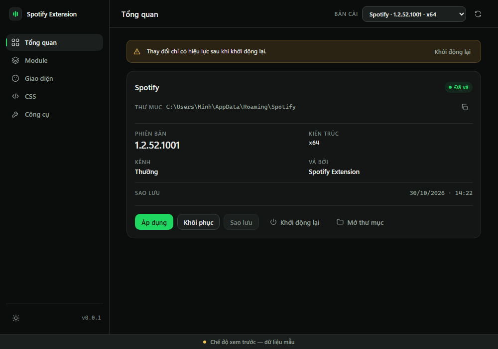
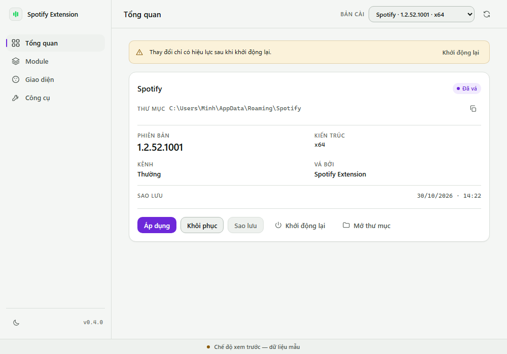

# Spotify Extension

Ứng dụng Windows quản lý phần tuỳ biến của **Spotify Desktop**: đổi giao diện, bật/tắt tiện ích, chỉnh màu, sao lưu và khôi phục client. Phần chạy bên trong Spotify là một payload TypeScript; phần quản lý là app desktop **Rust + Tauri 2** (~5 MB, dùng WebView2 có sẵn của Windows).

> Windows 10/11 64-bit · Spotify Desktop bản cài từ [spotify.com](https://www.spotify.com/download/windows/) · bản Microsoft Store chưa hỗ trợ.
>
> Hỗ trợ cả hai kiểu client: bản cũ có thư mục `Apps\xpui`, và bản mới đóng gói `Apps\xpui.spa` (Spotify 1.2.46+). Với bản đóng gói, **mỗi lần Spotify cập nhật**, app tự giải nén gói mới ra `Apps\xpui` rồi vá lại và giữ nguyên file `.spa` gốc; khôi phục chỉ cần xoá thư mục đã giải nén.




## Tính năng

| Nhóm | Nội dung |
| --- | --- |
| Bảng điều khiển trong Spotify | Nút nổi góc phải dưới: thông tin bài đang phát, chép link/URI, đổi màu nhấn, lời bài hát đồng bộ từ LRCLIB, tua ±10 giây, popup tên bài, đếm ngược thời gian, chẩn đoán |
| Theme | 9 theme dựng sẵn + tự thả theme vào thư mục dữ liệu |
| Tiện ích | 11 extension: adblock, auto skip explicit, quick keys, track copy, volume memory/wheel, playback speed, like hotkey, hide sidebar, focus mode, skip short tracks |
| Màu | 6 màu giao diện (nhấn, nền, sidebar, card, chữ, chữ mờ) + CSS tuỳ ý |
| An toàn | Sao lưu theo **từng phiên bản Spotify**, payload ghi qua thư mục tạm rồi đổi chỗ, `Khôi phục` trả client về nguyên bản |
| Song ngữ | Việt / Anh, đổi ngay trong app |

## Cài đặt

1. Tải `spotify-extension-windows-x64.zip` ở tab **Releases** (hoặc trong artifact của GitHub Actions khi chưa phát hành).
2. Giải nén vào một thư mục cố định, ví dụ `C:\Tools\Spotify Extension`.
3. Chạy `spotify-extension.exe`.
4. Nếu Windows hiện *"Windows protected your PC"*: **More info → Run anyway**. App chưa ký số nên SmartScreen cảnh báo; mã SHA-256 của bản tải nằm trong file `.sha256` cùng release — đối chiếu bằng `certutil -hashfile spotify-extension-windows-x64.zip SHA256`.

Cấu trúc thư mục sau khi giải nén:

```
spotify-extension.exe
runtime\runtime.js      ← payload tiêm vào Spotify
extensions\             ← 11 tiện ích
themes\                 ← 9 theme
snippets\               ← đoạn CSS
```

## Bốn trang trong app

| Trang | Việc |
| --- | --- |
| **Tổng quan** | Chọn bản Spotify, xem phiên bản/kiến trúc/trạng thái vá/thông tin sao lưu, và chạy Apply · Khôi phục · Sao lưu · Khởi động lại · Mở thư mục |
| **Module** | Bật/tắt tiện ích, chọn theme, bật snippet; tìm kiếm theo tên |
| **Giao diện** | Chọn theme cho Spotify và chỉnh 6 màu, có ô xem trước |
| **Công cụ** | Ngôn ngữ, Safe mode, kiểm tra cập nhật, đường dẫn Spotify, bảng chẩn đoán |

Thao tác làm thay đổi client đều ghi ngay vào `Apps\xpui`; **khởi động lại Spotify** để thấy kết quả (nút *Khởi động lại* trong app làm việc này).

## Cách hoạt động

1. **Sao lưu** — trước lần vá đầu tiên của mỗi phiên bản Spotify, app chép nguyên client vào
   `%APPDATA%\spotify-extension\backups\<id>\<phiên-bản>\` kèm `manifest.json`.
   Client dạng thư mục thì chép `xpui\`; client dạng gói thì chép chính `xpui.spa`.
   Bản sao luôn sạch: bỏ thư mục `sxe` và khối marker, nên khôi phục ra đúng bản gốc.
2. **Áp dụng** — nếu client còn ở dạng gói, giải nén `Apps\xpui.spa` ra `Apps\xpui`.
   Thư mục giải nén có một file đánh dấu phiên bản, nên khi Spotify cập nhật, app biết bản cũ đã lỗi thời và **giải nén lại gói mới** thay vì vá nhầm bản cũ.
   Sau đó ghi `runtime.js`, màu, `user.css`, các extension đang bật và `manifest.js` vào
   `Apps\xpui\sxe\`; thư mục mới được dựng cạnh đó rồi đổi chỗ, nên lỗi giữa chừng không làm hỏng bản đang chạy.
   Cuối cùng chèn một khối nhỏ vào `index.html` giữa hai mốc `<!-- sxe:start -->` và `<!-- sxe:end -->`.
3. **Khôi phục** — client dạng thư mục thì chép lại snapshot của đúng phiên bản đang chạy rồi xoá `sxe\`;
   client dạng gói thì xoá thư mục `Apps\xpui` để Spotify dùng lại `xpui.spa` gốc.
4. **Trong Spotify** — payload đọc manifest, dựng bảng điều khiển bằng Shadow DOM và nạp các extension đã bật.

## Cấu hình

File `%APPDATA%\spotify-extension\config.ini`, app tự tạo khi lưu thay đổi:

```ini
[Setting]
language = vi
spotify_path =
theme = Soft
check_update = 1

[AdditionalOptions]
extensions = adblock | volume-memory
snippets = hide-window-controls

[Colors]
accent = #1ed760
background = #121212
sidebar = #000000
card = #1f1f1f
text = #ffffff
subtext = #b3b3b3

[Feature]
safe_mode = 0
```

| Khoá | Ý nghĩa |
| --- | --- |
| `extensions` | Danh sách extension bật, ngăn cách bằng `\|` |
| `snippets` | Đoạn CSS bật, ngăn cách bằng `\|` |
| `theme` | Tên theme (`Soft`, hoặc theme tải từ kho) |
| `colors.*` | 6 màu giao diện |
| `language` | `vi` hoặc `en` |
| `safe_mode` | `1` = bỏ qua extension/tinh chỉnh khi áp dụng (để chẩn đoán) |
| `spotify_path` | Khoá thư mục Spotify khi máy có nhiều bản |
| `check_update` | `0` = tắt kiểm tra bản mới trong Spotify (bảng điều khiển vẫn đổi được) |

CSS tuỳ ý: bỏ vào `%APPDATA%\spotify-extension\user.css`, nội dung được nối vào sau cùng.

## Gỡ hoàn toàn

Bấm **Khôi phục** trong app (trả client về bản gốc và xoá `Apps\xpui\sxe`), rồi xoá thư mục cài đặt.
Dữ liệu người dùng nằm ở `%APPDATA%\spotify-extension` — xoá thư mục này là sạch hết cấu hình và bản sao lưu.

## Quyền riêng tư

- Khi mở mục lời bài hát, tên bài, nghệ sĩ, album và thời lượng được gửi tới `lrclib.net` để tìm lời.
- App kiểm tra bản mới bằng GitHub API; bản cập nhật chỉ tải từ tài khoản `github.com/ninokiru`.
- Báo cáo chẩn đoán chỉ được chép vào clipboard khi người dùng bấm nút — không tự gửi đi đâu.
- Không có telemetry, không đọc tài khoản Spotify.

## Phát triển

```
src-tauri/     Rust + Tauri 2 (app quản lý)
ui/            HTML/CSS/JS thuần, được nhúng vào exe
src/payload/   TypeScript chạy trong Spotify (esbuild → dist/payload/runtime.js)
extensions/    tiện ích .js
themes/        theme .css
snippets/      đoạn CSS rời
docs/          design spec, audit Tauri, ý tưởng mở rộng, mockup
```

- Build payload: `npm install && npm run build` (typecheck + esbuild).
- Build app: `cargo build --release --features tauri/custom-protocol --manifest-path src-tauri/Cargo.toml`.
- Test: `cargo test --manifest-path src-tauri/Cargo.toml`.
- CI (`.github/workflows/build.yml`) làm toàn bộ trên `windows-latest`; tag `v*` thì `release.yml` phát hành zip kèm `.sha256`.

Xem `docs/design-spec.md` (thiết kế giao diện), `docs/tauri-notes.md` (audit Tauri), `docs/extension-ideas.md` (ý tưởng mở rộng), `docs/ui-directions.md` (các hướng giao diện).

## Giấy phép

MIT.

---

## English

A Windows desktop app that manages Spotify customisation: themes, extensions, colours, backups and client restore. The manager is built with **Rust + Tauri 2**; the part that runs inside Spotify is a TypeScript payload.

- Download the zip from Releases, extract, run `spotify-extension.exe`. Unsigned build — SmartScreen will ask for confirmation.
- Four pages: **Overview** (install state, apply/restore/backup/restart), **Modules** (toggle extensions, pick a theme), **Appearance** (theme and six colours), **Tools** (language, safe mode, update check, diagnostics).
- Backups are kept per Spotify version under `%APPDATA%\spotify-extension\backups\<id>\<version>\`; the copy is pristine, so restore always returns a clean client.
- The payload is written to `Apps\xpui\sxe\` and `index.html` gets a small marker block, so repeated applies never duplicate and restore never touches anything else.
- Privacy: lyrics lookups go to `lrclib.net`; the update check uses the GitHub API; nothing else leaves the machine.
- MIT licensed.
